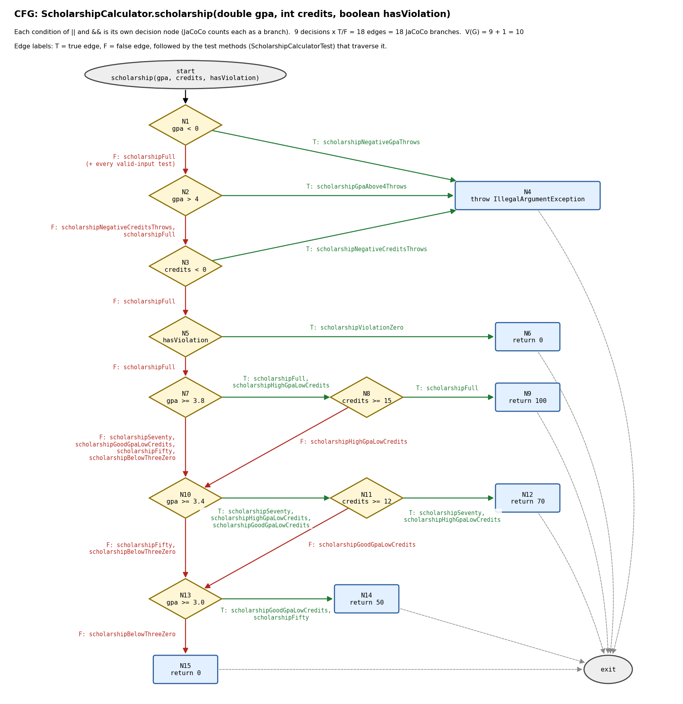

# Лаборатори №9: Код хамралт — JaCoCo-гоор тестээ хөтлөх

F.CSA313 — Программ хангамжийн чанарын баталгаа ба тест (2026)

- **Нэр:** Энхсаруул
- **Оюутны код:** B232270145

## Орчин

Ubuntu 24.04 (WSL2) дээр ажилласан.

```
$ java -version
openjdk version "21.0.12.1" 2026-08-18
OpenJDK Runtime Environment (build 21.0.12.1+1-1-24.04.4-Ubuntu)
OpenJDK 64-Bit Server VM (build 21.0.12.1+1-1-24.04.4-Ubuntu, mixed mode, sharing)
```

```
$ mvn -version
Apache Maven 3.8.7
Maven home: /usr/share/maven
Java version: 21.0.12.1, vendor: Ubuntu, runtime: /usr/lib/jvm/java-21-openjdk-amd64
Default locale: en, platform encoding: UTF-8
OS name: "linux", version: "6.6.87.2-microsoft-standard-wsl2", arch: "amd64", family: "unix"
```

Ажиллуулах: `mvn verify` → тайлан `target/site/jacoco/index.html`.

**pom.xml-д нэмсэн зүйл:** Maven 3.8.7 нь `maven-compiler-plugin`-ийн хуучин 3.1 хувилбарыг
автоматаар сонгодог бөгөөд тэр нь `maven.compiler.release=17`-г ойлгодоггүй
("Source option 5 is no longer supported" алдаа өгнө). Тиймээс `maven-compiler-plugin 3.13.0`-г
pom.xml-д тодорхой зааж өгсөн. Өөр тохиргоо өөрчлөөгүй.

## Хэсэг A: Happy path тестүүд ба эхний хэмжилт

5 хэвийн урсгалын тест: `letterGradeA` (95→A), `letterGradeB` (85→B), `gpaOfAAndB` ([95,85]→3.5),
`scholarshipFull` (3.9, 16, false→100), `scholarshipSeventy` (3.5, 13, false→70).

`results/jacoco-A.csv`-аас:

| | Missed | Covered | Хамралт |
|---|---|---|---|
| Line | 10 | 15 | 15/25 = **60%** |
| Branch | 21 | 20 | 20/41 ≈ **48.8%** |

**Ажиглалт:**
Шар ромботой мөрүүд нь хамгаалалтын нөхцөлүүд (`score < 0 || score > 100`, `scores == null || ...`,
`gpa < 0 || gpa > 4 || credits < 0`) ба `hasViolation` — тэдгээрийн зөвхөн худал тал нь ажилласан, учир нь
happy path тест хэзээ ч буруу оролт эсвэл зөрчилтэй оюутан өгдөггүй. Мөн `credits >= 15` ба
`credits >= 12` нөхцөлүүдийн зөвхөн үнэн тал шалгагдсан. Улаан 10 мөрөнд гурван `throw` зам бүгд,
`letterGrade`-ийн C/D/F, `gpa`-ийн switch доторх C ба D, `scholarship`-ийн 50% ба 0% буцаалт орсон —
өөрөөр хэлбэл алдааны замууд болон бага дүн/бага голчийн тохиолдлууд огт туршигдаагүй.

## Хэсэг B: CFG зурж branch 100% хүрэх



`scholarship()`-ийн CFG: `||` ба `&&` доторх нөхцөл бүрийг тусдаа шийдвэрийн зангилаа болгосон
(9 шийдвэр × T/F = 18 ирмэг = JaCoCo-гийн 18 branch, V(G) = 10). Ирмэг бүр дээр түүнийг дайрдаг
тестийн методын нэр бичигдсэн.

16 тест нэмж, нийт **21 тест** болсон (`results/mvn-verify-B.txt`: `Tests run: 21, Failures: 0`).

| Функц | Нэмсэн тест |
|---|---|
| letterGrade | `letterGradeNegativeThrows`, `letterGradeAbove100Throws`, `letterGradeC`, `letterGradeD`, `letterGradeF` |
| gpa | `gpaNullThrows`, `gpaEmptyThrows`, `gpaAllGrades` ([95,85,75,65,50]→2.0, switch default салаа) |
| scholarship | `scholarshipNegativeGpaThrows`, `scholarshipGpaAbove4Throws`, `scholarshipNegativeCreditsThrows`, `scholarshipViolationZero`, `scholarshipHighGpaLowCredits`, `scholarshipGoodGpaLowCredits`, `scholarshipFifty`, `scholarshipBelowThreeZero` |

`gpa < 0 || gpa > 4 || credits < 0` нөхцөлийн гурван дэд нөхцөл тус бүрд тусдаа `assertThrows` тест
бичсэн, `&&` нөхцөл бүрийн худал талыг (голч хангасан ч кредит дутуу) тусад нь шалгасан.

`results/jacoco-B.csv`: **BRANCH_MISSED = 0** (41/41), **LINE_MISSED = 0** (25/25).

## Хэсэг C: Давталтын заагийн тестүүд

| Давталт | Тест | Үр дүн |
|---|---|---|
| 0 удаа | `gpaLoopZeroEmptyThrows` | хоосон массив → `assertThrows(IllegalArgumentException)` |
| 0 удаа | `gpaLoopZeroNullThrows` | `null` → `assertThrows(IllegalArgumentException)` |
| 1 удаа | `gpaLoopOne` | [95] → 4.0 |
| 2+ удаа | `gpaLoopMany` | [95, 85, 75, 65] → 2.5 |

Нийт 25 тест болсон ч хамралт 41/41, 25/25 хэвээр — өсөөгүй.
Хамралт зөвхөн давталтын бие ажилласан эсэхийг тоолдог болохоос хэдэн удаа эргэснийг ялгадаггүй.
Харин хуваагчийг буруу тоолох, эхний утгыг буруу онооход гарах эсвэл off-by-one алдаа зөвхөн
1 удаагийн ба олон удаагийн тохиолдлыг тусад нь шалгахад л илэрдэг тул эдгээр тест хэрэгтэй хэвээр.

## Хэсэг D: Хамралт 100% — гэхдээ алдаа амьд

Зааг утгын 7 тест нэмсэн: `letterGradeBoundary60IsD`, `letterGradeBoundary5999IsF`,
`letterGradeBoundary6999IsD`, `letterGradeBoundary0IsF`, `letterGradeBoundary100IsA`,
`letterGradeBoundary8999IsB`, `letterGradeBoundary90IsA`.

`mvn test` → 32 тестээс 1 унасан (`results/mvn-test-D-fail.txt`):

```
[ERROR]   ScholarshipCalculatorTest.letterGradeBoundary60IsD:158 expected: <D> but was: <F>
[ERROR] Tests run: 32, Failures: 1, Errors: 0, Skipped: 0
```

**Алдаа:** спецификацид 60–69.99 → "D" гэсэн боловч код `if (score > 60) return "D";` байсан тул яг 60
оноо "F" болж байсан. **Засвар** (тусдаа commit `89b2d6e`): `score > 60` → `score >= 60`.

Засварын дараа (`results/mvn-verify-final.txt`): `Tests run: 32, Failures: 0`, BUILD SUCCESS.
`results/jacoco-final.csv`: **BRANCH_MISSED = 0** (41/41), **LINE_MISSED = 0** (25/25).

**Гол дүгнэлт:**
Хэсэг B-д branch хамралт 100% байхад энэ алдаа кодонд байсаар байсан.
`score > 60` ба `score >= 60` хоёулаа яг ижил хоёр салаа (үнэн/худал) үүсгэдэг тул 65 (үнэн) ба 50 (худал)
гэсэн хоёр тест JaCoCo-г бүрэн хангаж, ялгааг огт харуулаагүй.
Хоёр нөхцөлийн ялгаа ганцхан утга дээр — яг 60 дээр — гарах бөгөөд зөвхөн тэр зааг утгыг шалгасан тест л алдааг барьсан.
Хамралт нь аль мөр, аль салаа ажилласныг хэмждэг, харин тэр салааны нөхцөл спецификацитай таарч байгаа эсэх,
үр дүн зөв эсэхийг хэмждэггүй.
Тиймээс хамралт бол туршигдаагүй кодыг олох зайлшгүй хэрэгсэл боловч зөв ажиллагааны хангалттай нотолгоо биш —
зааг утгын шинжилгээ болон спецификацид суурилсан тесттэй хамт хэрэглэх ёстой.

## Commit түүх

```
89b2d6e Fix letterGrade: > 60 -> >= 60, spec says 60 is D
4fbbb19 Part D: boundary tests expose letterGrade bug
f915fca Part C: loop boundary tests for gpa() (0 / 1 / 2+)
ab9583c Part B: 100% branch and line coverage + CFG
5cd7189 Part A: happy path tests + coverage A
```

## AI туслах ашигласан тухай

Энэ лабыг Claude (Anthropic, Claude Code) AI туслахын тусламжтай гүйцэтгэсэн:

- Тестийн файл (`ScholarshipCalculatorTest.java`) дахь A–D хэсгийн тестүүдийг Claude санал болгож бичсэн;
  тест бүрийг нэмэхээс өмнө би жагсаалтыг нь хянаж зөвшөөрсөн.
- `pom.xml`-ийн compiler plugin-ийн асуудлыг Claude оношилж засах санал гаргасан.
- **`cfg.png`-г гараар зураагүй** — Claude matplotlib ашиглан кодоор зурсан. Ирмэг бүр дээрх тестийн нэр
  тест файл дахь бодит методын нэртэй таарч байгааг шалгасан.
- `mvn verify`/`mvn test`-ийн гаралтыг `results/` руу хадгалах, commit-уудыг Claude миний WSL дээр ажиллуулсан;
  commit бүр `Co-Authored-By: Claude` мөртэй.
- README-ийн ноорогийг Claude бичсэн; тоо бүрийг `results/` доторх файлуудтай тулгаж шалгасан.
